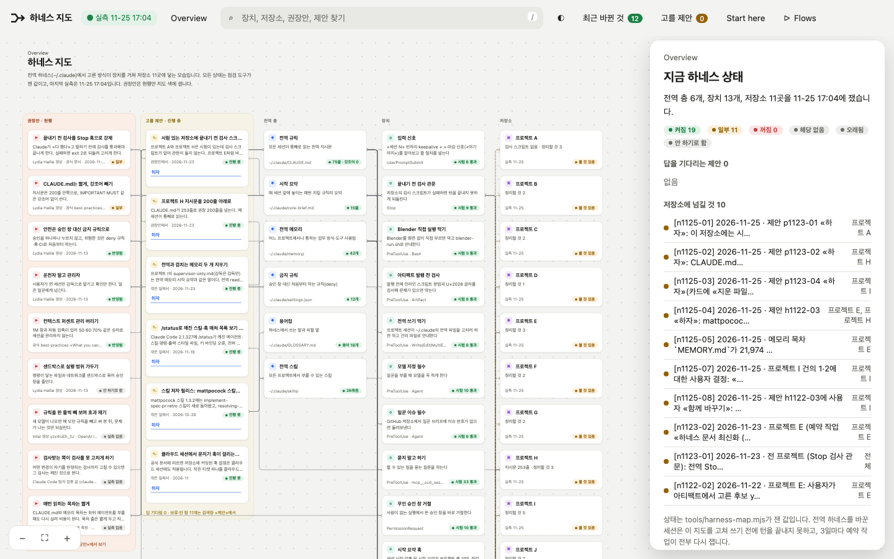

# 하네스 검토 묶음

비개발자 한 사람이 Claude Code 세션 여러 개를 «감독»과 «일꾼»으로 나눠 굴리면서 만든 작업 환경(하네스)입니다. 이 묶음은 그 하네스를 읽고 의견을 주실 분을 위해 꾸린 사본입니다. 원본 저장소·메모리·대화 기록은 들어 있지 않습니다. 프로젝트 이름은 «프로젝트 A»~«프로젝트 K»로 가렸습니다.

## 하네스가 하는 일

- **전역 하네스**: 모든 프로젝트에서 똑같이 적용되는 규칙·시작 요약·용어집·훅(자동으로 걸리는 검사)·도구·전역 메모리. `harness/` 폴더가 이것입니다.
- **개별 하네스**: 프로젝트마다 따로 두는 메모리와 규칙. 전역 규칙과 다르게 하는 것만 적습니다. 프로젝트 쪽 내용은 이 묶음에 넣지 않았고, 구조만 아래 그림에 이름을 가려 보입니다.
- 원칙은 «지켜야 할 규칙은 메모리에 적지 말고 훅·시험·금지 설정 같은 장치로 만든다»입니다. 프로젝트 세션은 전역을 고치지 못하고 건의만 올립니다(`harness/docs/adr/0002`).

## 구조 그림



전역 층(규칙·시작 요약·메모리·스킬), 장치(훅), 저장소 11곳(프로젝트 A~K)이 어떻게 이어지는지 보여 주는 «하네스 지도»를 이름을 가린 데이터로 구운 그림입니다.

## 읽는 순서

1. `harness/CLAUDE.md` — 모든 세션이 읽는 전역 규칙
2. `harness/core-brief.md` — 세션이 시작될 때 매번 들어가는 요약
3. `harness/docs/adr/` — 결정 기록 3건(왜 이렇게 했는지)
4. `harness/hooks/` — 규칙을 지키게 하는 장치와 `tests/`
5. `harness/memory/` — 전역 메모리(업무 방식·도구 함정)

용어는 `harness/GLOSSARY.md`, 켜 둔 플러그인과 연결 서비스, 개인 설정은 `plugins-and-connectors.md`에 있습니다.

## 깔고 지우기

따로 쓰는 설정 폴더(`CLAUDE_CONFIG_DIR`)에 깔기 때문에 평소 쓰시는 `~/.claude`와 업무 세션은 건드리지 않습니다. 설정 폴더에서 Claude Code에 로그인해야 합니다.

```
git clone <이 저장소 주소> ~/harness-review
CLAUDE_CONFIG_DIR=~/harness-review/harness claude
```

> 참고: `harness/hooks/tests/`의 시험은 원래 맥에서 126개 모두 통과합니다. 이 묶음에서는 14개가 실패합니다. 이름을 가리면서 시험이 기대하는 실제 프로젝트 이름이 바뀌었고, 묶음 폴더가 git 저장소의 맨 위가 아니어서 «전역 저장소»로 알아보지 못하며, settings.json을 훅·금지 규칙만 남기도록 줄였기 때문입니다.


지울 때:

```
rm -rf ~/harness-review
```

이 사본에서만 경로를 «설정 폴더 변수가 있으면 그것, 없으면 `~/.claude`»로 바꿨습니다(`hooks/harness-layers.mjs`, `hooks/require-agent-model.mjs`, `hooks/stop-check-gate.mjs`, `settings.json`의 훅 명령). 문서와 안내 문구 속의 `~/.claude` 표기는 원본 그대로입니다. 일부 훅 시험과 도구(`tools/`)는 원본 맥의 폴더 구조(저장소 11곳, 프로젝트 메모리)를 전제로 하므로 이 맥에서는 일부가 실패하거나 빈 결과를 낼 수 있습니다.

## 특히 봐 주셨으면 하는 것

(사용자가 채울 자리)

의견은 사용자에게 직접 전해 주세요. 의견을 거두는 장치는 만들지 않았습니다.
